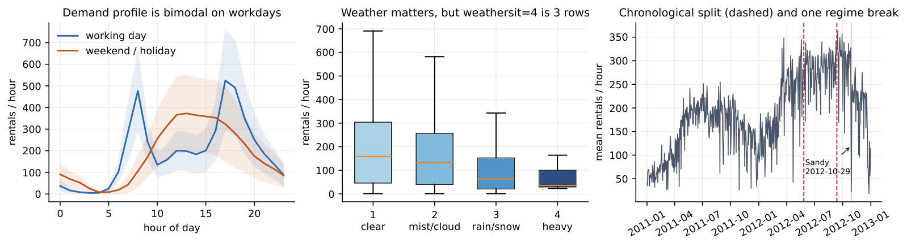

# probabilistic-completion

Learning an internal representation of partially observed data — and knowing when to distrust it.

<p align="center">
  
</p>

## The problem

Predict hourly bike rentals (UCI Bike Sharing, 17,379 hours, Washington D.C., 2011–2012) under the
assumption that some of the inputs may be *missing at prediction time*.

Each hour is treated as a partially observed vector `[o, y]`: `o` holds 15 observable covariates in
two blocks — 9 temporal features (cyclic hour, day-of-week, day-of-year, year, holiday, working day)
and 6 weather features (temperature, apparent temperature, humidity, wind speed, two weather-situation
flags) — and `y`, the rental count, is the block that is never observed when it matters.

What makes it more than a regression problem:

1. The model must predict `y` **and** report how uncertain that prediction is, per input.
2. The observation itself is a variable: the weather block can be masked entirely at test time, and
   the same weights must keep working and say how much worse they have become.
3. The uncertainty has to be *checked*, not just produced. A number labelled "95% interval" that is
   right 80% of the time is a liability.

Leakage is controlled explicitly: `casual` and `registered` sum exactly to the target, so both are
removed from the input space, along with the row index and the raw date.

## What the code does

| § | experiment |
|---|---|
| 1 | data audit: chronological split, leakage check, feature blocks |
| 2 | mask-aware encoding: 30 inputs = 15 values + 15 mask bits |
| 3 | representation: linear probes and PCA on the 32-d code |
| 4 | depth: residual deep net vs shallow MLP at **identical** parameter count (108,002 each) |
| 5 | Gaussian readout: mean and log σ, NLL training, temperature calibration |
| 6 | varying the observation: reveal `k` of the 6 weather features, all subsets |
| 7 | reliability: coverage, PIT, rank correlation, error capture, two failure cases |

## Headline results

| quantity | deep | shallow |
|---|---|---|
| test RMSE (bikes/h) | **104.7 ± 4.0** | 124.2 ± 1.6 |
| test NLL | **0.859 ± 0.276** | 0.971 ± 0.028 |
| 95% coverage (test) | 0.894 | 0.911 |
| seed-to-seed spread of RMSE | ±4.0 | ±1.6 |

*Depth buys accuracy and likelihood, and costs stability and calibration.* A single constant σ fitted
on validation residuals is *more accurate* (RMSE 99.8) and marginally better covered, but far worse
on likelihood (NLL 1.119) — the learned σ field is what makes the likelihood usable and the hard hours
rankable.

*The uncertainty responds to the information that was removed.* With the same weights, hiding the
weather block raises σ by 11–15%; revealing weather features one at a time walks σ down from 70.0 to
58.6 bikes/h while the error falls from 118.8 to 101.1. Nothing in the objective said which sensors
were more informative.

*But it is informative about ranking and misleading about scale.* σ orders the errors well (Spearman
0.73; the top σ decile captures 52% of the total absolute error, against 10% for chance), yet the mean
absolute error reaches ≈1.5σ in that decile: 22% of the PIT mass sits in the top bin.

Two failures are documented rather than smoothed over:

- **Evening peaks** violate their 95% band 14–19% of the time (RMSE 159.3, coverage 0.806) while quiet
  nights are almost perfectly covered (RMSE 19.2, coverage 0.978). The model is confident exactly where
  the world is hardest.
- **Hurricane Sandy** (29 Oct 2012): the model over-predicts by ≈70% (159.5 vs 93.2 bikes/h) for a full
  day while its interval still looks respectable. Distribution shift is not uncertainty, and a
  probabilistic model cannot detect it on its own.

## Run it locally

Requires Python 3.10+.

```bash
git clone <this-repo-url> probabilistic-completion
cd probabilistic-completion
python -m venv .venv
source .venv/bin/activate        # Windows: .venv\Scripts\activate
pip install -r requirements.txt

jupyter lab probabilistic_completion.ipynb
```

Then *Run All* (Kernel → Restart & Run All). The notebook is self-contained: it reads
`data/hour.csv` if present and downloads it otherwise, trains three seeds per architecture, writes
every figure to `figures/` and every headline number to `results/results.json`. About one minute on a
CPU — no GPU needed.

## Layout

```
probabilistic_completion.ipynb   all experiments, top to bottom, with outputs
paper/main.tex, main.pdf         13-page write-up of the same study
data/hour.csv                    UCI Bike Sharing, hourly aggregation
figures/                         figures produced by the notebook
results/results.json             every number quoted in the paper
requirements.txt
```

To rebuild the paper:

```bash
cd paper && pdflatex main.tex && pdflatex main.tex
```

## Stack

PyTorch for the models, NumPy/pandas for data handling, scikit-learn for linear probes, PCA and a
gradient-boosting reference model, SciPy for normal quantiles and rank correlations, Matplotlib for
figures.
